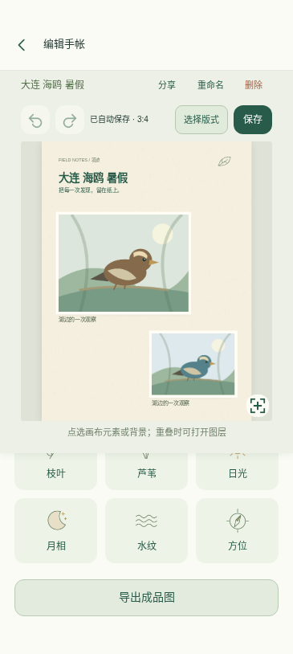
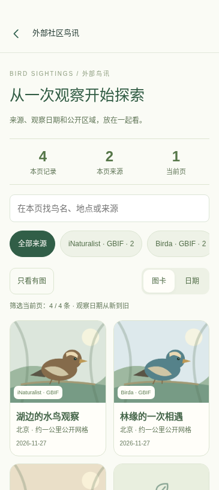
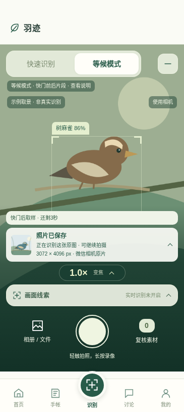

# 0.4.22：手机布局与识别片段候选

2026年11月28日。独立分支 `feat/capture-and-layout-0.4.22`，包含0.4.21工程评审及CloudBase源码。0.4.20冻结上传基线、团队PR #30与业务服务器未改；未代上传体验版。

## 本轮结果

- 手帐编辑页漏算了名称栏。现在名称栏34、工具栏54、说明28、间距12，共128px；固定在实测页头下方，控制区占剩余高度并独立滚动。底部留安全区，导出／保存按钮可完整滚入屏幕。截图中的悬浮视频属于微信／系统，不是手帐元素。
- 地图原先明确关闭旋转／俯视，现在允许双指操作，新增「朝北 · 2D」恢复视角，保留中心与倍率。是否显示具体三维建筑由原生地图与地区支持决定。
- 外部鸟讯统一原生按钮尺寸、来源条高度与筛选对齐；图卡同排等高、日期置底、图片保持比例，宽窗口支持三列。
- 登录后「我的」主资料与社区共用昵称／预设头像；本机访客资料不自动上传。社区账号新增核对信息复制，只含AppID、服务地址、社区ID与鸟友号，不含令牌／OpenID。匿名只是隐藏公开署名，不生成另一个人。
- 手帐新增真正的图片左／右文字栏，上下／自由位置也可选择；AI文字应用位置同步扩充。重排作用于画布与导出，保留原图、撤销；放不下时拒绝本次修改。
- 帧缓存清理补充保护手帐撤销／重做中的照片，以及帖子完整草稿和恢复副本中的附件。

## 两种识别模式

| 项目 | 快速模式 | 等候模式 |
|---|---|---|
| 本机取样目标 | 每秒1帧，最多60秒 | 等待时每秒2帧 |
| 快门 | 先拍原图，保留现有本机观察／相册流程 | 同时启动快门后5秒加密取样，目标每秒5帧 |
| 快门前 | 实际已有的5秒稀疏环形片段 | 实际已有的5秒稀疏环形片段 |
| 挑选 | 没有手动拍摄时，超时可选最多2张备用线索 | 最多1张之前、2张之后的线索，相似／平坦帧会减少数量 |
| 结束 | 暂停相机，明确恢复后重开会话 | 回到稀疏等待 |

这不是连续录像，也不保证真机达到目标帧率。编码慢时主动降频，手动拍摄期间让出处理机会。冷启动没有发生过的前5秒不能补造。纹理／曝光仅用于挑帧，不是鸟类检测或识别置信度。

片段压缩图保留总量上限4 MiB、单张160 KiB、长边640px；原始RGBA不跨回调保留。原生画布、在途上传和原有实时恢复帧另有分配，4 MiB不是整个进程内存承诺。需真机测热量、电量、帧率后再提高频率。

本机片段不自动联网、落盘或保存相册。只有明确「开启」画面识别才上传分析副本；等候窗口结束后最多单独分析2张，展示实际完成数，不把不同帧的框／分数伪装成快门原图结果。「复核片段」才将选中一张物化为复核文件；「丢弃」、替代窗口、切模式、离开取景会清理未采用片段。已保存观察、手帐与草稿引用的原件继续保护。尚未实现跨帧／音视频融合。

微信的 `createMediaRecorder` 录制的是指定WebGL画布，不是任意原生相机预览或手机屏幕回录接口。因此本轮采用真实相机帧的有界稀疏缓存，不宣称截屏回录更省资源。

相机原本已配置 `resolution="high"` 和 `quality:'original'`；新增显示系统实际返回像素。不会把分析缩略图当原片，也不能承诺手机原生相机的高像素、HDR、长焦计算与连拍能力。高速飞鸟／远处拍摄仍适合先用系统相机，再导入原图；实时路线的价值是快速候选、反应延迟补救与直接记录。

## 账号与后续服务边界

仓库鉴权采用同一AppID／微信OpenID的稳定身份，再映射为社区成员；同一微信换设备应在同一持久数据库获得相同社区ID。需与线上服务实际配置核对。当前后端只接受六种预设头像，本轮不能让本机上传肖像通过不存在的头像接口跨设备同步；自定义头像媒体／审核／迁移需后续服务契约，不能按昵称合并账号或暴露匿名作者。

豆包图片理解可接现有「明确选1–4张压缩副本→生成可编辑文字与受限构图→校验→预览→应用→撤销」流程。图片生成另作明确选择，不修改原图或捏造鸟名、时间地点；密钥留在服务端。本轮完成接入设计，未调用／计费／上线模型。

0.4.21独立CloudBase收藏副本与业务服务器无技术依赖；仍需真实环境ID／类型、AppID绑定与部署权限，保持未启用。[CloudBase操作边界](CLOUDBASE-VAULT-0.4.21.md)。手帐云端原片归档仍是后续项目，完整便携备份继续负责微信全量清除前的保护。

## 验证

492项客户端测试通过；25 WXML／27 WXSS原生模板编译。38窗口×12状态共456项源码布局投影检查通过：编辑页导出按钮可达、来源按钮未裁切、卡片对齐、横向无溢出、快门／提示边界正确。投影采用项目示例插画和测试像素数，不是真机验收。

仍需Pura手机及iOS／其他Android复测：编辑器键盘与底部操作、地图双指／复位、两设备同账号与另账号隔离、快速模式60秒／恢复、等候前后5秒／重复快门／长按录像、内存与温升。已有地图鉴权及passive警告（R34）继续保留跟踪，未静音。线上识别与自定义头像等待队友服务，CloudBase等待合法环境配置。

[完整英文工程说明与主来源](en/CAPTURE-AND-LAYOUT-0.4.22.md) · [私人英文当前计划](https://github.com/NoctisBaguette/bird-assistant-miniprogram/blob/main/docs/NEXT-STEPS.md)。

## Source projections / 源码投影

Fixture illustrations; these are not WeChat device screenshots. / 项目示例图，不是真机截图。

