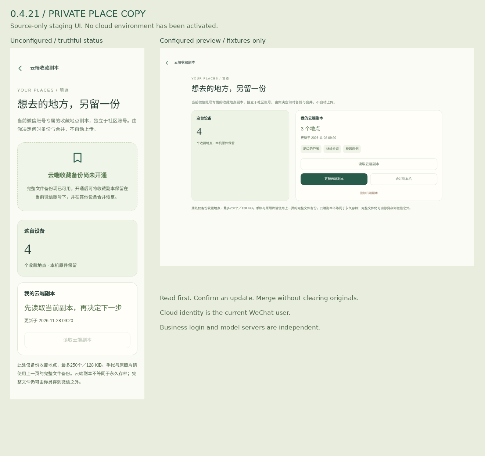

# 独立CloudBase收藏副本：0.4.21

新 `cloudfunctions/birdPrivateVault` 直接使用腾讯托管云函数／文档集合保存私人收藏地点，不调用现有FastAPI、GPU、Qwen或社交API。旧birdGateway只是业务代理，仍依赖业务服务器；新函数没有该依赖。入口：「我的 → 本机备份与恢复 → 云端收藏副本」。当前跟踪配置关闭、环境ID空，页面如实显示尚未开通；没有创建资源、修改套餐或自动付费。

## 开通所需与顺序

1. 团队的环境ID、传统／PG类型、实际套餐／到期日，以及与真实小程序AppID的绑定。需要合法的环境管理／部署会话，不要提供密码、模型Key或从本工作区实例元数据发现凭据。
2. 只创建 `bird_private_place_backups_v1` 集合；PG先启用pgdoc。普通客户端无读写权限（ADMINONLY），由云函数服务身份操作；客户端不直连集合。
3. 只允许目标函数的已认证小程序调用。传统环境可合并函数目录中的经典规则示例；PG使用OPA，不能粘贴旧函数规则。保留其他策略，不开公网HTTP、定时器或数据库触发入口。
4. 使用函数自己的锁文件及vendor入口包部署，选择环境实际提供的Node22／24普通函数运行时。暂存环境设 `BIRD_VAULT_APP_ID` 为真实AppID、`BIRD_VAULT_ENABLED=true`；短小数据库操作按免费环境执行预算设计，实际冷／热启动仍须测量，不自动升付费。
5. 原客户端npm ci／verify；`npm run verify:cloud`单独重装函数依赖、跑4项离线检查及审计，不进行部署／真实CloudBase调用。保留审计后的锁文件，勿自动降级SDK或换beta。
6. 完成下面真实权限试验后，再有意识地修改 `services/cloud-vault-config.ts` 的环境和enabled。SDK只在用户按操作后初始化。原AppID／私有项目配置保留；新模板仅补cloudfunctionRoot，已有配置由setup保留，环境管理者按实际工程补该路径。

## 合同与保证

仅read／write／remove。每次读取可信SDK APPID／OPENID，校验服务端配置AppID；忽略事件里的身份、URL和集合名。AppID＋OpenID派生私有文档键，不向客户端暴露身份原值。写入带expectedRevision与操作ID；唯一首次插入或带“owner＋旧revision”的原子更新。陈旧设备不能覆盖新副本；相同操作重试幂等，更改内容后复用ID会拒绝。删除保留更高版本的墓碑，防止旧设备复活旧副本。本机原件不受云端删除影响。

每个用户保留一个最新副本，上限250地点／128 KiB；校验名称、地址、日期、唯一ID和坐标。没有照片／手帐上传，不是历史归档。未知结果须重新读取，不自动重试写入。合并保留本机相同坐标及名称，只加缺少地点，ID冲突另分配。

云归属为当前微信用户，与社区账号登录独立；社区退出不代表切换云身份。资料调用使用稳定Node SDK4.2.1；wx-server-sdk4.0.2只读可信微信上下文，不用于PG资源操作。PG通过pgdoc复用文档API。仍须验证环境真实策略，未用猜测SQL或beta替代。

依赖审计最初有6项传播告警，现用Axios0.34.0与Lodash4.18.1入口适配修复，4项离线测试验证普通路径／原型遍历拒绝、自有回环HTTP兼容、实际文档SDK条件更新序列及入口身份拒绝。重装审计0告警（2026-11-28），不等同真实签名传输／云权限验收。

## 暂存验收／回退

两名真实微信测试用户交替冷／热调用：各读空、各存自己的地点、只能取回自己的副本。确认匿名／错误AppID和普通客户端集合直连均拒绝。同微信两设备同时读相同版本，冲突更新只能一个成功；失败端先重读。测未知结果、空副本、删除后陈旧重试、坐标／ID冲突、本机合并、前后台及超时。检查客户端未传业务Bearer／照片／模型密钥。

测实际超时、资源用量与到期日。回退关闭客户端功能和目标函数调用，保留云文档与本机／文件备份，不以删集合回退代码。

腾讯当前列出免费体验版每月3000资源点，普通函数3秒／256 MiB；旧微信IDE环境的权益／续期规则可能不同，正式发布后也有到期规则。不能据用户上传体验版就假定正式发布，必须看团队控制台。此源码没有付费兜底。

原照片云备份下一阶段应直传私有存储，并带元数据完成记录、版本CAS、字节校验、中断恢复及明确保留策略；不能把64 MiB文件塞进三秒函数、默认公开私图，或仅收到上传响应就删本机原件。现在仍可用完整文件备份。

官方资料核对： [概述／环境](https://cloud.tencent.com/document/product/876/56375)、[计费及限制](https://cloud.tencent.com/document/product/876/127357)、[PG](https://docs.cloudbase.net/quick-start/pg-overview)、[pgdoc与权限](https://docs.cloudbase.net/database/postgresql/pg-doc-usage)、[OPA](https://docs.cloudbase.net/envconfig/authz-opa/intro)、[函数访问控制](https://docs.cloudbase.net/cloud-function/security-rules)、[运行时](https://docs.cloudbase.net/en/cloud-function/runtime-support)。实际SDK／版本也经安装包和npm核对。现在等待的是环境选择、绑定和合法部署权限，非队友业务服务器恢复。
