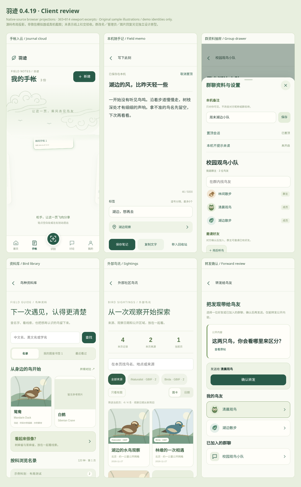

# 0.4.19：鸟友社区与本机随手记候选

2026年11月28日，北京时间。用户已报告上传0.4.18体验版；该版冻结在 `release/experience-0.4.18`，团队PR #30已进入审查，合并仍需有写权限的队友批准。**本分支是独立的0.4.19候选，未代上传体验版。**

## 本轮可检查的内容

| 入口 | 行为 | 保存与服务边界 |
| --- | --- | --- |
| 手帐长按／上划 | 保留已认可的雾出现时机与日期行下边界；雾从页面标题下方开始，加入原创祥云线条和6只错时淡入鸟影。长按时移除常驻绿边，仅保留向外扩散并消散的光圈。 | 本机动效；下划删除不加顶部雾，不新增闲置超时。 |
| 我的→我的随手记 | 标题／正文／标签搜索、置顶、自动保存、关联本机观察、复制文字、回收站还原。 | 本机文字，最多300篇、每篇5000字；不复制原图、不上传、不计云端贡献。 |
| 更多→找鸟友 | 复制自己的鸟友号，搜索允许被发现的人；收到／发出的申请独立显示，进入主页或私信。 | 沿用现有账号、好友与隐私接口。 |
| 消息／群聊 | 本机备注、会话置顶、本机未读提示设置、可恢复的隐藏私信／回复通知；群资料抽屉中找成员、看群主身份、邀请好友、退出／解散。 | 本机设置和未发送文字按社区账号隔离；群成员与操作权限仍以服务器为准。关闭保留X、空白、标题栏下拖。 |
| 帖子→转发给鸟友／群聊 | 先选择接收者并确认，再发送公开帖引用；打开卡片重新读取原帖可见性。 | 复用现有文字消息接口；仅传公开内容ID／标题，不传私人照片、临时URL或精确坐标。 |
| 帖子回复 | 长回复组可展开／收起；保留引用楼层、鸟种建议与本机草稿。慢响应只清除已提交的那份文字。 | 沿用文字／楼中楼接口；旧服务不支持引用时要求先取消引用，不静默改成普通回复。 |
| 更多→鸟种资料库 | 全名录搜索和翻页；当前页按科分组；本机图鉴书签／最近看过；图文精选与已有并排对比。 | 图鉴书签不等于已观察鸟种；详情仍依赖服务。 |
| 更多→外部鸟讯 | 图卡／日期时间线、来源筛选、本页文字搜索、只看有图。 | 明示筛选限当前页，保留原观察日期顺序、来源、许可与公开精度。不是完整实时鸟讯。 |
| 我的→成长／设置 | 真实云端计数与徽章门槛分开；公开图鉴照片缓存独立显示与清理。 | 不增加虚构成就或模拟社交数据。 |

## 数据保护与回退

随手记逐篇比较修订号，保存前重新读取并合并其他笔记；冲突时保留当前文字，可另存一份。回收站操作可还原，不删除关联观察。损坏数据不覆盖，观察列表损坏也不阻止独立写笔记。存储失败保留页面文字，页面返回按钮会等待保存成功。系统强制结束进程或设备存储失败时，不宣称内存文字拥有云端持久性。

私信草稿保存重试标识；不确定的发送结果沿用同一标识，修改正文后换新标识。旧成功回调不清空新文字。账号变化后先清空上一账号的结果，再请求新资料。隐藏会话可恢复，新消息会重新出现；隐藏通知不删除回复原件。原有前台10秒轮询保留，不宣称推送或实时连接。

公开参考图只缓存匿名鸟种照片接口，最多32张／16 MiB，单张3 MiB以上仅临时展示。7天内优先读缓存，断网可回退到不超过30天且来源／作者／许可一致的缓存。换图或署名变化会重新取图。并发下载合并索引，清理只允许缓存目录；清理失败会停止扩容，损坏索引不能指向原图删除。手帐、私人观察、私信媒体和原照片不在此缓存内。

## 待讨论的交互设计

[社交控件设计预览](design/social-controls-0419.html)明确标记“示例内容／不请求服务器／不上传”，可试群主、管理员与普通成员身份、群名／公告、成员移除与撤销、邀请确认以及带图回复。刷新重置。真实小程序未把缺少接口的群改名、管理员与图片回复伪装成已上线功能。

[社交与媒体后续决策](SOCIAL-CLIENT-0.4.19.md)记录现有能力与建议合同。按用户最后指示，**本轮不恢复或开发服务器，不改凭据，不部署、不启用CloudBase**。识别／融合与更深的手帐编辑工作仍留在原待办。

## 验证与交接

最终本机结果：**446测试通过、0失败／跳过；23 WXML／25 WXSS编译；30设备×41状态共1230源码布局通过记录的几何检查**。数量与限制见同名 evidence JSON。客户端 `npm run verify` 包含类型、微信模板编译及存储／账号隔离／慢响应测试；30个设备配置的源码投影增加本轮页面。投影不是微信模拟器，不能替代真机触摸、权限、帧率或线上服务联调。

下一次体验上传前，在既有微信工程完整Compile，保留AppID、私有配置、助手终端与本机数据。先测随手记新建／自动保存／搜索／删除还原，手帐静止／上划／下划／分享返回，图鉴书签与外部筛选；再用两个测试账号联调好友申请、屏蔽、私信失败重试、入群确认和公开帖转发。检查新抽屉X／空白／下拖关闭及内外滚动隔离。原48项和R01–R90保留，本轮新增R91–R104。
