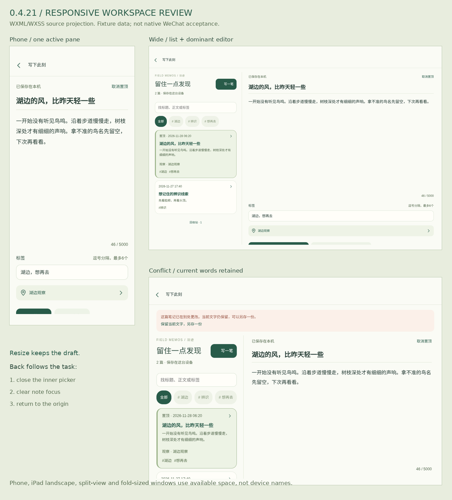

# 0.4.21：工程与交互评审

2026-11-28，北京时间。0.4.20冻结为用户计划上传的候选，尚未代查控制台确认上传；本轮在独立 `feat/engineering-review-0.4.21` 分支。原体验版0.4.18、团队PR#30与队友负责的业务服务器保持原状态。

| 优先级 | 发现 | 本轮结果 |
| --- | --- | --- |
| P1 | 两个动画涟漪圈传小数线宽，与控制台circle_1／circle_2警告相符 | 全程传正整数像素；保留九秒、拖动缩放时地理附着及绿色洗白。原生警告是否消失仍待复验。 |
| P1 | 随手记列表把完整5000字正文发给渲染层，300篇可能超过桥接预算 | 只发110字摘要；300篇回归小于200 KiB。 |
| P1 | 云端副本需隔离微信用户、防止旧设备覆盖新版本；SDK可能返回错误对象而不抛异常 | 独立birdPrivateVault函数：可信SDK身份、私有键、条件更新、删除版本墓碑、幂等重试，错误不伪报成功；不依赖现有业务服务器。 |
| P1 | 新云SDK依赖审计有6项传播告警 | 固定Axios0.34.0、Lodash4.18.1安全入口适配，保留稳定Node SDK4.2.1／wx-server-sdk4.0.2；重装、离线兼容测试与审计通过，0告警。 |
| P2 | App.onLaunch同步读取两套保护资料；用户日志140ms | 启动返回后加载，合并扫描／迁移；不把它等同于原生总启动耗时已达标。 |
| P2 | 页头只初始化一次，0状态栏被当24px，无胶囊时可能占满右侧 | 尺寸变化重算，尊重0px状态栏，无胶囊回退16px右留白。 |
| P2 | 双栏需明确焦点、滚动、返回、未保存草稿 | 列表／编辑分别滚动；折叠保留草稿与列表偏移。切换先保存，失败留当前。返回先关关联选择，再退出笔记焦点，再离页；脏编辑启用平台离页保护。 |
| P2 | 小号浅绿说明对比偏低 | 新随手记／云副本说明提高到12px与更深绿色；不宣称全应用无障碍已通过。 |

## 控制台分类

- 涟漪线宽、启动同步工作已在源码修正；须原生重复定位、拖动／缩放并重测冷启动。
- canary3.17.1来自DevTools所选SDK；应与本机已安装的稳定版对照，不猜测版本，也不覆盖私有配置。
- 域名／TLS／证书检查关闭是用户DevTools设置；跟踪模板原已开启urlCheck。发布仍要真实AppID、合法域名和有效HTTPS，不能以跳过检查证明生产连通。
- 渲染层鉴权／网络错误仍未闭环：单条信息无法区分原生地图授权／网络和业务登录，不以反复登录、乱换AppID处理。
- passive listener警告仍需原生事件目标／调用栈。应用没有直接preventDefault调用，不以移除弹层滚动隔离来消音。
- 热更新、LazyCodeLoading与localhost SDK预加载属于工具／运行时信息，本项目没有对应preload标签，没有隐藏这些日志。

R34完整原生鉴权／闲置故障继续开放。手帐、识别与hub控制器仍较大，后续按边界抽取状态／视图模型，不为格式化进行无关重写。随手记仍是本机KV；离页保护不意味着清除微信全部数据后仍在。完整文件备份明确仅覆盖地点／手帐。若两个保护记录文件均损坏，停止合并、保留现场；专门修复流程仍待做。

下一步独立于业务服务器：经反馈后把双栏模式用于资料库／详情、论坛列表／帖子；再做逐篇版本与删除墓碑的私人笔记同步、带私有桶／完成记录／校验／保留策略的原照片云备份。社区账号、审核、投票、私信群聊继续使用现有业务权威数据。

[窗口与返回设计](WORKSPACE-NAVIGATION-0.4.21.md) · [独立CloudBase开通](CLOUDBASE-VAULT-0.4.21.md)。客户端475通过（新增17项），25 WXML／27 WXSS编译；另4项离线SDK检查及依赖审计通过。38窗口×18状态=684投影，另152笔记窗格专项检查；均不替代原生触摸、地图、键盘及云权限验收。

一次早期SDK引导测试尝试访问实例元数据以发现运行时凭据，自动审批审查已阻止；最终改为数据库解析器模拟并禁止外部／元数据网络，仅允许自有回环HTTP夹具。没有为测试索取或发现真实云凭据。完整Compile、真机／iPad／折叠与云环境双账号权限验证仍待验收；本轮未代上传或部署。
