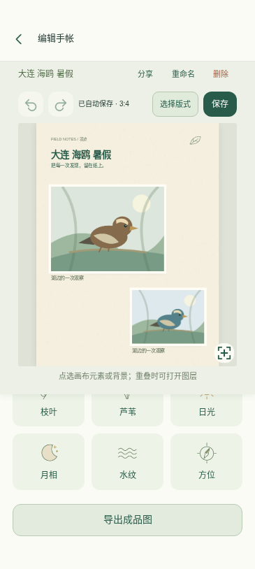
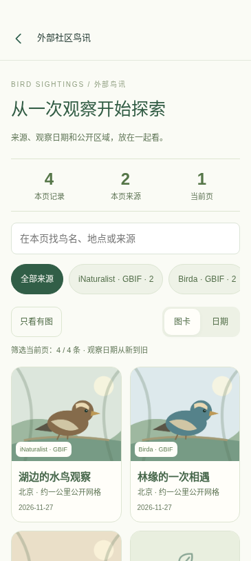
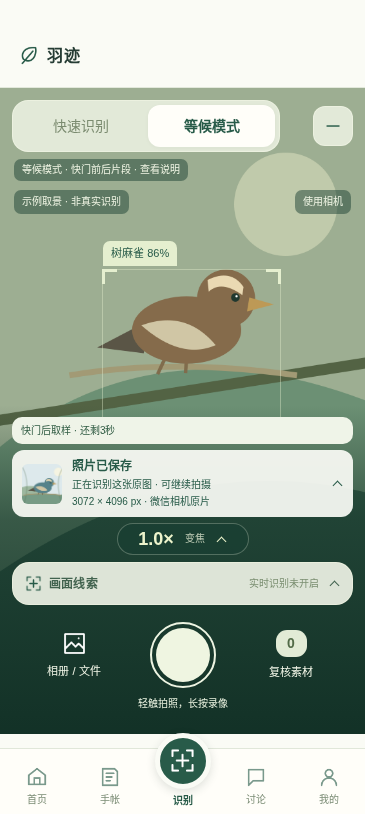

# Capture and phone-layout revision 0.4.22

28 November 2026, Beijing time. This separate review candidate includes all 0.4.21 work. The frozen 0.4.20 upload checkpoint and team PR #30 are unchanged. No business service, provider credential, cloud environment or experience upload was changed.

## What is implemented

- The journal editor now accounts for its name row as well as the toolbar, caption and spacing: 128 CSS pixels in total. Its viewport is fixed below the measured custom header; the controls own the remaining scroll area. Bottom padding lets the final export/save actions scroll fully into view, including the safe area. The floating video player in the supplied phone screenshots belongs to WeChat/the OS, not the journal document.
- Map rotation and overlooking gestures are enabled. Native gesture events update the displayed orientation; **朝北 · 2D** resets orientation without changing the chosen center or zoom. The map's existing geographic markers and integer-width ripples remain. Tilt is a viewpoint, not a promise of detailed 3D buildings everywhere.
- External sightings own their button metrics. Source pills fit a 56px horizontal strip, filter/segment hit areas align, photos preserve their crop, cards stretch to a common row baseline, and dates stay at the bottom. Phone and wide-window grids are checked separately.
- Signed-in My uses the community nickname/avatar as its primary identity. Local guest settings remain separate and are not silently uploaded. Account diagnostics copy only the AppID, service origin, community member ID and handle; no login token, OpenID or private content. Anonymous posts retain their anonymity.
- Journal text can be placed left/right of photos, above/below them or freely. Side lanes reflow the actual document and export geometry; they are not preview-only decorations. Oversized side text is refused on a copy, leaving the authored document unchanged. Undo and original photo paths are retained. AI text placement has the same left/right choices.
- Disposable-frame cleanup now protects photos referenced only by journal Undo/Redo and both complete/recovery forum drafts. An unreadable authoritative manifest stops cleanup.

## Fast and wait capture behavior

The native camera has one frame listener. A local buffer runs independently of business-server login; optional online detection consumes that listener rather than installing a second one. Manual shutter work temporarily suspends both frame encoding and live forwarding.

| Policy | Fast / 快速 | Wait / 等候 |
|---|---|---|
| Foreground local sampling target | 1 frame/s | 2 frames/s while waiting |
| Button action | Request original shutter photo | Request original shutter photo and start the post-tap window |
| Before the tap | Recent sparse 5-second ring; at most two best fallback frames across this fast session | Recent sparse 5-second ring |
| After the tap | Continue the bounded fast session | Target 5 frames/s for 5 seconds |
| Selected helpers | Up to 2 only if no manual photo was taken before timeout | Up to 1 pre-tap plus 2 post-tap frames; similar/flat frames can reduce the count |
| End | Pause the camera at 60 seconds; explicit resume starts a new session | Return to sparse waiting after the five-second burst |

These are maximum target rates, not promised hardware frame rates. Cold starts have only the history actually observed. JPEG encoding that takes over 100ms lowers local sampling to at most 1 frame/s for the next two seconds. Manual photo capture wins over helper frames. A simple texture/exposure heuristic ranks candidates; it does not detect birds or produce species confidence.

The retained encoded buffer is capped at **4 MiB**, each helper at **160 KiB**, with a maximum long edge of **640px**. Raw RGBA frames are not retained between callbacks. There are additional bounded native canvas, in-flight transport and existing live-recovery allocations; 4 MiB is not a claim about total process memory. Native battery, thermal, dropped-frame and image-quality measurements remain pending.

Only an explicit **开启** sends live analysis copies. If it is active when a wait window finishes, at most two selected helpers are analysed separately with their own timestamps. The UI reports the actual analysed count. The shutter original remains a separate primary observation; helper boxes and scores are not relabelled as original-photo results. Cross-frame tracking/fusion or combined audio/video inference is not implemented by this client change.

Selected helper bytes remain in RAM. **复核片段** explicitly materialises one helper for review; saving an observation or using it in a draft/journal protects that file. **丢弃**, a replacement capture window, mode change or leaving capture clears unused helpers. Hide/unload/recording stop listeners, timers and pending helper analysis; late callbacks cannot restart them. Photos requested by the manual shutter retain the existing private-observation/gallery behavior and are never deleted as helper cache.

## Why this is not screen replay

The official WeChat API describes `createMediaRecorder` as recording a supplied **WebGL canvas**. It is not an API for retrospectively recording arbitrary native camera preview or the whole phone screen. A screen-based design would still have to acquire and encode frames in advance. It is not assumed to be cheaper.

This candidate implements a sparse, five-second camera-frame buffer instead of claiming continuous five-second video replay. The camera remains `resolution="high"`, with `takePhoto({quality:'original', captureMetadata:true})` for the manual shutter. The returned photo's real pixel dimensions now appear on the capture card when available. Analysis copies never replace that file. The API cannot promise the system camera's telephoto processing, HDR, motion burst, high-megapixel modes or proprietary computational photography.

Live capture is useful for a quick candidate, a short reaction-delay recovery and a direct observation workflow. For distant or fast flight where photo quality is the priority, **system camera first → original import later** remains a supported first-class route. Live identification is not presented as a replacement for the phone's camera app.

## Cross-device account boundary

Repository authority already uses `wx:<AppID>:<OpenID>` as the authentication subject, then stores one community member for that subject. A persistent business database with the same AppID and WeChat account should return the same member ID on both devices. Login does not automatically grant access to a person's real WeChat nickname/avatar.

The current server profile schema supports six preset avatar IDs. This revision aligns their display; it does **not** make an uploaded local portrait synchronise through an API that only accepts preset IDs. Custom avatar media, avatar moderation and any account migration need a coordinated server contract. Do not merge people by nickname or device ID, and do not reveal an anonymous post's hidden author to work around a display issue. If the account IDs differ, compare diagnostics and investigate the actual deployed authentication configuration/database with the teammate.

## Doubao media/design work prepared for the next service revision

The existing journal provider already accepts up to four explicitly selected photo copies and returns editable text with a constrained style/variant plan. Doubao image understanding can fit this boundary; it is not equivalent to image generation.

The next adapter should run on the service, with its key kept there. Send only selected analysis copies and the current factual instructions. Keep the saved journal name, photo IDs/original bytes and uncertain species/date/location unchanged. Return a validated draft schema: brief/captions plus one of the known styles and variants, and a bounded placement such as left/right/above/below. Apply to a copy, check text fit and geometry, preview, then allow Undo. Do not execute arbitrary layout coordinates or treat an image-understanding description as verified bird identification. Generated backgrounds/illustrations would be a separate opt-in operation with a preview and source label. No Doubao model was called, enabled or billed in this revision.

CloudBase private-bookmark source from 0.4.21 remains available independently of the business server. Its configuration remains disabled/empty. Activating it still needs the legitimate team's environment ID, database type, AppID binding and deployment/access checks described in [CLOUDBASE-VAULT-0.4.21.md](CLOUDBASE-VAULT-0.4.21.md). Journal-original cloud storage is a separate future feature; the portable full backup remains the protection against a complete WeChat data wipe.

## Validation and remaining acceptance

**492 client tests pass; 25 WXML and 27 WXSS compile with the bundled native template compilers.** New tests cover capture timing, cold starts, memory pressure, pre/post diversity, manual priority, listener ownership, one-minute pause/resume, late hide callbacks, two-helper upload limits, account stale-response protection, map reset, side text geometry/serialization/atomic refusal and Undo/forum attachment protection.

**456 source-layout cases = 38 window sizes × 12 states** cover portrait/square/landscape editors, selected captions, side text, external gallery/timeline, capture/burst/timeout, profile and tilted-map controls. No horizontal overflow, clipped source pills, card baseline mismatch, inaccessible export button or live shutter/hint bounds failure was found. These are HTML projections of checked-in WXML/WXSS, not native WeChat or physical-device acceptance. Review screenshots use project sample illustrations and fixture pixel dimensions, not the user's personal photos.

Native acceptance before replacing an experience build:

1. On the Pura phone: open/edit each paper ratio, scroll controls to the last action, open the keyboard, rotate/resize where supported and confirm the final buttons remain reachable.
2. On phone maps: two-finger rotate/tilt, drag/zoom, focus a row and reset north-up. Existing map-auth/passive-listener warnings remain open; enabling gestures is not a fix for service authentication.
3. On the same WeChat account on two phones: compare community IDs, edit a preset avatar/nickname, refresh My and community; verify a second account remains isolated. Check anonymous author privacy separately.
4. Fast mode: untouched timeout, fallback review, manual original save, explicit resume, page hide and background return. Wait mode: cold tap, five seconds of pre-history, post-tap burst, repeated tap replacement, flat/no-bird scene, pause and long press/video. Confirm actual frame rate, temperature and memory on iOS, Huawei and another Android device before raising the rates.
5. With the authorised business service available: verify that helper results remain separate from originals and that network failure keeps originals/helpers reviewable without a busy lock. No server work was resumed merely to simulate a success.

## Primary references checked

- [WeChat official API typings](https://github.com/wechat-miniprogram/api-typings/blob/master/types/wx/lib.wx.api.d.ts): `onCameraFrame`, `takePhoto`, `createMediaRecorder`; installed package 5.2.3 was also inspected.
- [Tencent Location Service map guide](https://github.com/TencentLBS/tencentmap-miniprogram-skill/blob/main/references/map_component_guide.md): `enable-rotate`, `enable-overlooking`, region-change rotation/skew.
- [Taro camera documentation](https://docs.taro.zone/docs/components/media/camera): high-resolution and frame-size capabilities vary by supported platform; another platform's `outputDimension` must not be applied to WeChat.
- [Volcengine image understanding](https://docs.volcengine.com/docs/ark/image-understanding?lang=zh): image input/provider boundary; no credential/model activation was performed.

## Source projections / 源码投影

Fixture illustrations; these are not WeChat device screenshots. / 项目示例图，不是真机截图。

