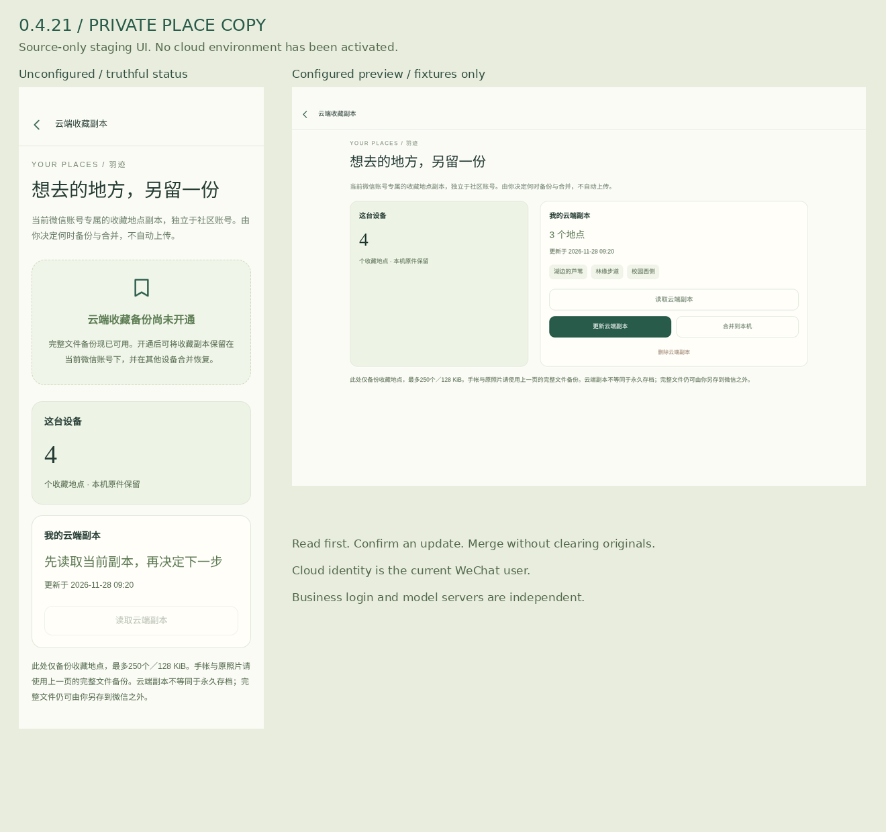

# Independent CloudBase place vault — 0.4.21

## What is independent

`cloudfunctions/birdPrivateVault/` implements **private saved-place snapshots**, using Tencent-managed functions and a document collection. It does not call our FastAPI business server, GPU service, Qwen, social API or the older `birdGateway`. That older gateway is a proxy and therefore still depends on the business server; this new function does not.

The native client entry is **My → 本机备份与恢复 → 云端收藏副本**. Source is complete for a staging trial, but the tracked configuration is disabled with an empty environment ID. The UI truthfully shows that cloud backup is not open. No Tencent resources, subscriptions or billing settings were created/changed here.

## Exactly what is needed to activate

1. The team's **CloudBase environment ID**, whether it is **traditional** or **PG**, its current plan/expiry and confirmation that it is bound to the actual mini-program AppID. These are environment metadata, not passwords or provider keys.
2. A legitimate environment-owner deployment session/IAM access. No credential may be discovered from this workspace's instance-metadata service. Use the team's actual console/authorized deployment process.
3. Create only the collection `bird_private_place_backups_v1`. For PG, enable `pgdoc` first. Set **no ordinary client read/write permission (ADMINONLY)**; client code never accesses the collection directly. Verify the function's service identity can perform its three intended operations.
4. Configure invocation for **this function only**. Traditional environments may merge `security-rules.classic.example.json` into their current rules. PG environments use **OPA**, not the legacy function-rules JSON; use the actual environment's authenticated mini-program invocation policy. Do not replace unrelated policies or attach public HTTP/timer/database triggers to this WeChat-context handler.
5. Deploy `birdPrivateVault` with its own lockfile and vendor entry-point packages. Choose the available Node22/24 regular-function runtime. Set server variables `BIRD_VAULT_APP_ID=<actual AppID>` and `BIRD_VAULT_ENABLED=true` only for the intended staging environment. Its small DB operations target the free tier's short execution budget; measure cold/warm latency and stay within that environment's actual timeout. No paid upgrade is required by this source.
6. Run the existing client `npm ci`, `npm run verify`; separately `npm run verify:cloud` performs a clean function dependency install, four offline checks and an audit. It makes no deployment or live CloudBase call. Keep the patched lockfile: do not run an automatic downgrade or replace stable SDKs with beta versions as a shortcut.
7. After the real access tests below, deliberately set `services/cloud-vault-config.ts` to that environment and `enabled:true` in the staging client. SDK initialization occurs only after a user requests the operation. Keep the actual AppID/private project config; the tracked project template merely declares `cloudfunctionRoot` for new checkouts. Existing local configs are preserved by setup and may need that root added by the owner.

## Contract and storage

Actions are only `read`, `write`, `remove`. Trusted `getWXContext()` APPID/OPENID are read on every invocation; event identity/URLs/collection names are ignored. The configured AppID must match. An owner key derived from AppID+OpenID addresses exactly one private document. The response exposes only revision, timestamp, presence and saved places.

Writes carry `expectedRevision` and an operation ID. The adapter inserts a unique owner document for revision0 or atomically updates a query containing both owner and expected revision. A stale device cannot replace a newer snapshot. Retrying the same operation/content returns its prior result; reusing the ID with changed content fails. Deleting the cloud copy retains a higher revision/tombstone, so an old device cannot recreate the pre-deletion snapshot with an old revision. No deletion affects local originals.

The snapshot is limited to **250 places /128 KiB**; names, addresses, dates, uniqueness and coordinate ranges are validated server-side. Exactly one latest snapshot is retained, not an archive history. No photos or journal documents are uploaded. Unknown results/timeouts require reading the cloud copy again; there is no automatic retry/fallback write. Local merge preserves current same-coordinate records and adds missing places with collision-safe IDs. It never clears local collections.

Cloud ownership is the current WeChat user, **independent of community login**. Logging out of a community account does not imply changing WeChat cloud identity. Friend/private-media sharing is not granted by this vault.

## PG/traditional and dependency decisions

Data uses stable `@cloudbase/node-sdk@4.2.1` (PG-compatible); `wx-server-sdk@4.0.2` supplies only trusted WeChat context, not PG resource operations. Both environment modes still need their actual policy/SDK access verified. The Node SDK's document API is reused through `pgdoc` when PG is selected; a speculative SQL schema or a beta wx-server-sdk was not substituted.

The initial dependency graph had6 propagated audit entries. The function pins Axios0.34.0 and replaces the abandoned standalone `lodash.set/unset` imports with tiny API-compatible adapters to maintained Lodash4.18.1. The adapters include no copied third-party implementation. Offline tests verify ordinary nested paths, prototype-traversal rejection, local HTTP request/response compatibility, the pinned document serializer's conditional update and entry-point identity rejection. Clean-install audit reports0 advisories as of28 November2026. This does not replace live signed-transport/IAM verification.

## Staging acceptance and rollback

Use two real staging WeChat users: each reads empty state, saves their own place, and can retrieve only their own snapshot in alternating warm invocations. Confirm direct client collection access and anonymous/wrong-AppID invocation are denied. With one user on two devices, have both read the same revision: exactly one conflicting update may win; re-read the loser before another decision. Check unknown-response retry, empty snapshots, cloud deletion, stale post-deletion writes, local ID/coordinate collisions and foreground/background return. Confirm the native client sends no business bearer, private photos or provider credentials.

Measure cold/warm completion against the selected timeout and review real resource usage/expiry. Rollback disables the client flag and function invocation; preserve cloud documents and local/file backups. Do not delete a collection to roll back code.

## Free usage and remaining work

Tencent currently documents a free experience tier with3,000 resource points/month; the listed free regular-function limit is3 seconds /256 MiB. Entitlement and renewal differ for older WeChat-created environments, and the pricing page includes expiry changes after mini-program publication. An experience upload is not assumed here to be a formal release. Inspect this team's actual console before treating its quota/expiry as known. No automatic paid fallback is configured.

Original-photo cloud archives should use direct private storage uploads with metadata completion/CAS, byte checksums, interruption recovery and explicit retention. They must not stream a64 MiB archive through a three-second function, make a private file public, or delete a local original merely because an upload request returned. Portable files remain available now.

Primary sources checked28 November2026: [CloudBase overview/setup](https://cloud.tencent.com/document/product/876/56375), [pricing/limits](https://cloud.tencent.com/document/product/876/127357), [PG overview](https://docs.cloudbase.net/quick-start/pg-overview), [pgdoc usage and permissions](https://docs.cloudbase.net/database/postgresql/pg-doc-usage), [OPA](https://docs.cloudbase.net/envconfig/authz-opa/intro), [function access control](https://docs.cloudbase.net/cloud-function/security-rules), [runtime support](https://docs.cloudbase.net/en/cloud-function/runtime-support). SDK versions/actual interfaces were checked against the installed packages and npm registry. Live activation remains pending environment selection/access, not the teammates' business server.
