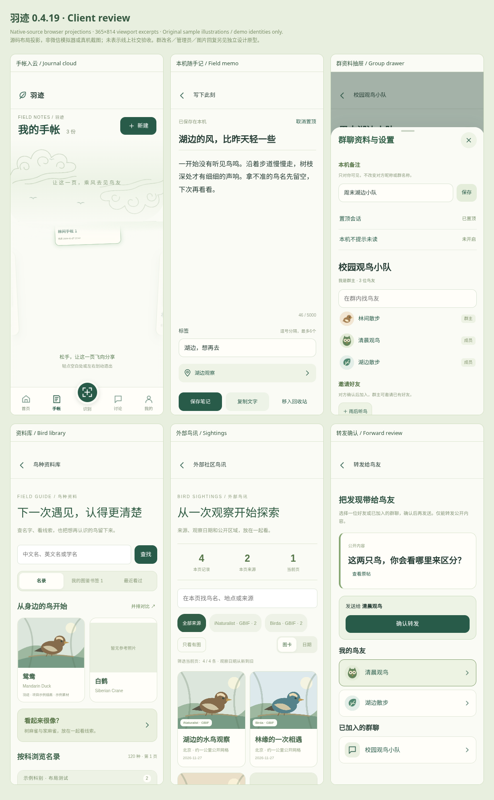

# 0.4.19 — community and personal field notes

28 November 2026, Beijing time. A separate **candidate**, built after the user reported uploading 0.4.18. The uploaded checkpoint remains frozen at `release/experience-0.4.18`; team PR #30 is ready for review and requires a teammate's approving review. Do not replace that upload with this branch without native acceptance.

## What to try

| Entry | Reviewable behavior | Storage / service boundary |
| --- | --- | --- |
| Journal → hold → drag up | Original cloud-scroll outlines and six staggered bird silhouettes fill the cloud field below the page title. The existing measured lower fog boundary and entry opacity calculation are retained. | Local animation; reduced-motion fallback. Downward deletion stays clear. |
| Journal → hold still | Constant green card ring is removed while armed; only the expanding green-to-white wave remains. | No idle timeout, new touch lock or changed share callback. |
| My → My field memos (`我的随手记`) | Search title/body/tags, pin, autosave, link an existing local observation, copy text, recover from trash. | Device-local text, up to 300 notes / 5,000 characters each. No photo copy or upload; independent of community login. |
| More → Find birders | Copy your bird handle, find discoverable people, review incoming/outgoing requests, open a profile or conversation. | Existing account/friend API; permissions remain authoritative. |
| More → Messages / Groups | Local conversation remarks, pins, unread-indicator preference, recoverable hidden notifications and DM rows; group member search and owner invitation controls in a closeable drawer. | Remarks/pins/hidden items/drafts are scoped to the server account on this device. Quiet only suppresses this device's unread indicator; it is not push muting. |
| Post → Forward to birder / group | Select an existing friend or joined group, inspect destination, then explicitly send a reference to the public post. Open the shared card to resolve current visibility. | Existing text-message API. Recheck public visibility before send; no embedded private files, arbitrary URLs or copied photos. |
| Post replies | Fold long reply groups, retain quoted floor and bird suggestion in an account-scoped local draft; late acknowledgements preserve newer typing. | Existing text/threaded-reply API. Old services keep the target explicit and require cancellation before an ordinary reply. |
| More → Bird library | Search the full served catalogue, page results, family grouping of the loaded page, local guide bookmarks and recently opened entries; photo-led featured section and existing comparison. | Local shelf metadata does not count as an observed species. Detailed records still need the service. |
| More → External sightings | Photo cards or observation-date timeline; source chips, text search and photo-only filter explicitly apply to the loaded page. | Existing external-record endpoint; original date order, source, licence and public precision remain authoritative. |
| My → Growth | Score and badge criteria are separated visually, with earned/remaining progress derived from real account counts. | Existing growth response; no invented achievements or count for device-only memos. |
| My → Settings | Separate, bounded public-reference-photo cache with a cleanup control. | Anonymous species-photo route only; local originals and private media are excluded. |

The native application has **no simulated chat history or example social accounts added**. Fixture illustrations and people appear only in layout review and the standalone design prototype.

## Local state and failure recovery

Notes compare the edited note's revision against fresh storage before merging. A concurrent change is rejected and the current text can be saved as a new note. Trash is reversible and never removes its linked observation. Corrupt note data is left intact; corrupt observation data does not block independent note editing. Storage errors keep current text and prevent the page's own Back action from discarding it. Native app termination or a device storage failure still cannot guarantee an unsaved in-memory edit; no background/cloud durability is claimed.

DM drafts retain the operation reference after an uncertain send. Editing produces a new reference; an old success clears only the submitted text. Account changes clear the previous account's results before a new account request completes. The ten-second foreground social poll remains; no push or realtime connection is implied. Hiding a DM row is reversible and a different latest message makes it reappear. Hidden reply notifications can be restored; original messages/replies remain untouched.

Reply drafts are account/post scoped and retain body, quoted reply, bird suggestion and reference. If a saved draft arrives after typing has started, neither version is silently overwritten: the user chooses which to retain. The same reference is retried after an uncertain response. A success arriving after further typing records the submitted species snapshot while preserving the new composer. Successful submission means accepted for the existing moderation flow, not publicly approved.

## Public reference photos

Only `GET /api/v1/species/{id}/photo` is eligible, with **no bearer or private-media URL**. Up to 32 derived images / 16 MiB are retained; a single image over 3 MiB is displayed from its temporary download without adding it to persistent cache. Reuse is preferred for seven days; a matching cached reference can be used after network failure until age 30 days. The image identity includes source URL, author credit and licence, so a changed source cannot attach new attribution to old artwork.

Downloads coalesce, concurrent completions merge into a fresh manifest, and least-recently-used entries are evicted within an owned cache directory. Failed eviction stops cache growth. Invalid manifests cannot redirect deletion into original media. Cache failure falls back to a temporary image or the existing anonymous route; it never makes a guide read/write into a new upload. This is image caching, not a complete offline field guide or a newly enabled CloudBase sync.

## Future design to review

Open [social-controls-0419.html](../design/social-controls-0419.html) from the repository. Its persistent banner labels **demo data, no requests, no upload**. Try owner/admin/member permissions, group naming/announcement, membership removal/undo, consent-based invitation, collapsed reply groups and local image selection. Refresh resets the demonstration. The existing mini-program does not expose these unsupported group mutations or image replies as working actions.

[Social and media decisions](SOCIAL-CLIENT-0.4.19.md) distinguishes shipped client behavior from proposed contracts. Server restoration, deployment, credentials, CloudBase activation, new group roles/rename endpoints, reply attachments and per-reply reactions/reporting remain deferred by the user's latest instruction. Identification/fusion and deeper journal/editor work remain in the existing backlog.

## Validation and native acceptance

Final local result: **446 tests passed,0 failed/skipped;23 WXML/25 WXSS compiled;1,230 source layouts over30 device profiles passed the recorded geometry checks**. See the sibling evidence JSON for exact scope and limits. `npm run verify` includes TypeScript, WeChat WXML/WXSS compilation and storage/session/late-response tests. `scripts/review-phone-layouts.mjs --workbench` adds the new screens to the existing 30 device profiles; the Python review checks overflow, sheets, close shape, journal hit area, hint overlap and card/tab bounds. These are source projections, **not a WeChat emulator**, gesture/FPS certification or live service acceptance.

Before a new experience upload, fully Compile in the existing WeChat project, keeping AppID/private configuration/helper terminal/local data. Start with notes create/edit/trash/restore, journal still/up/down and share return, library/source filters, then use two staging accounts for request/accept/block, DM retry, group invitation acceptance and public-post forwarding. Confirm drawer X, backdrop and header drag close, independent body scrolling, and no background movement. Check Pura 80 and a short/narrow profile; keep the 0.4.18 release branch as rollback.
