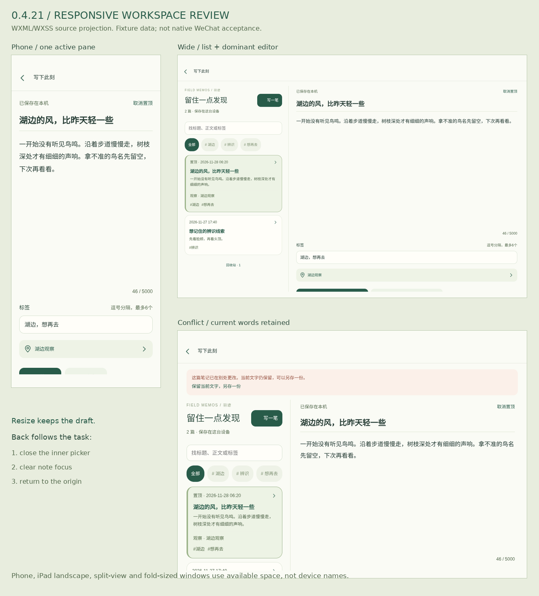

# 0.4.21 — engineering and interaction review

28 November 2026, Beijing time. **0.4.20 is the frozen upload candidate; the user reported the intention to upload, not a verified console upload.** This work is on a separate `feat/engineering-review-0.4.21` branch. It changes the client and independent CloudBase preparation; the teammates' existing business server and uploaded0.4.18/team PR#30 are untouched.

## Findings and resulting behavior

| Priority | Finding in the source / supplied console | Result |
| --- | --- | --- |
| P1 | The two animated map rings send fractional stroke widths, unlike the integer-width central dot. Those two rings match the reported `circle_1/circle_2` PolylineStyle warnings. | Positive integer stroke widths throughout all animation phases/zoom levels. Geographic attachment, nine-second lifetime and green-to-white wash remain. This is a source-level diagnosis; the exact native warning still needs a retest. |
| P1 | Notes list rows include each complete5,000-character body, although the UI displays only110 characters.300 valid notes can exceed the renderer bridge budget. | Summary rows omit full bodies. The300-note regression stays below200 KiB; selection reads the full original only when needed. |
| P1 | Cloud backup must not rely on caller-supplied account IDs or overwrite a newer device's snapshot. SDK errors can resolve as error objects rather than throw. | Independent `birdPrivateVault`: trusted WeChat SDK context, owner-derived document keys, revision-checked atomic updates, retained deletion revisions and idempotent retries. Resolved SDK errors fail closed. No business-server bearer is involved. |
| P1 | Fresh dependency audit found6 propagated advisory entries in the selected Cloud SDK dependency graph. Automatic downgrade suggestions would lose required SDK capabilities. | Pin Axios0.34.0 and maintained Lodash4.18.1 entry-point adapters; retain stable Node SDK4.2.1 / wx-server-sdk4.0.2. Clean reinstall, SDK parser/HTTP compatibility checks and production-dependency audit pass with0 advisories. |
| P2 | `App.onLaunch` synchronously loads/reads both complete protected collections; the supplied log reports140ms. | Load protection after launch returns and scan/migrate the two collections together. Ordinary domain reads can protect data sooner. This removes that work from synchronous launch; total native startup latency is not measured here. |
| P2 | Shared header metrics are attached once, assume a nonzero status bar, and can reserve almost the entire desktop window when the capsule rectangle is absent. | Recompute on resize; respect a real0px status bar; fall back to16px right clearance when there is no capsule. |
| P2 | A split notes view needs explicit focus, draft and Back behavior. List scroll must not turn into a different outer-page scroll owner after folding. | List/editor own bounded scroll containers in both modes; draft and list offset survive resize. Changing notes flushes first, and a failed save preserves focus/text. Back closes the inner picker, then note focus, then the route. Native unsaved-change protection is enabled while dirty where supported. |
| P2 | Small green captions on cream/selected backgrounds are faint. | New notes/cloud views use12px functional captions and darker green, with a measured contrast check. This is a scoped improvement, not a claim of whole-app accessibility compliance. |

## Console triage

| Supplied message | Ownership / next action |
| --- | --- |
| App.onLaunch140ms | Actioned as above. Re-measure real cold start, first map readiness and interaction latency; moving work after launch alone does not certify total startup performance. |
| MultiPolyline `circle_1/circle_2` width | Actioned integer payloads. Reproduce a complete ripple while dragging/zooming in the same DevTools build, then a physical phone. |
| Base library is canary3.17.1 | DevTools' selected SDK. Compare with an installed stable release in Local Settings; no guessed SDK version or user's private config was imposed. |
| Legal-domain/TLS/certificate checks disabled | The user's DevTools setting. The tracked template already enables URL checking. Real release acceptance needs the real AppID, registered request domains and valid HTTPS; bypassing checks is not evidence of production connectivity. |
| Renderer authentication/network failure | Still open. This message alone does not distinguish native map-service authorization/network from business authentication. Capture the failing request/SDK context; do not repeatedly log in or replace AppID as a speculative repair. |
| Unable to preventDefault in passive listener | Still open native reproduction. Application source contains no direct `preventDefault` call. Removing modal scroll ownership would reintroduce background scrolling, so it was not used to silence this warning. |
| Hot reload, lazy-load/system entries, localhost SDK preload messages | DevTools/runtime output. The app owns none of those preload tags. They were not hidden or reported as application fixes. |

R34's complete native authentication/idle failure remains open. Existing long-idle/touch behavior still needs physical-device acceptance.

## Review boundaries and next work

The large journal/identify/hub page controllers remain a maintainability cost. Further features should continue extracting pure state/transport/view-model modules rather than expanding those controllers or performing an unrelated formatting rewrite. Private field memos still use local KV storage; native unload protection helps pending edits but does not make them survive a full WeChat wipe. The0.4.20 portable archive explicitly covers places/journals, not all personal modules. If both protected record snapshots are unreadable, recovery stops rather than overwriting the evidence; a dedicated repair flow remains future work.

Immediate independent work after feedback: extend the approved two-pane pattern to bird-library/detail and forum list/thread; implement private note sync with per-note revisions and deletion tombstones; then original-photo cloud archives with private buckets, completion records, checksums and explicit retention. Keep existing business accounts, moderation, voting, messages and groups authoritative rather than creating a second social backend.

[Window and Back design](WORKSPACE-NAVIGATION-0.4.21.md) · [Independent CloudBase setup](CLOUDBASE-VAULT-0.4.21.md).

## Evidence and acceptance

475 client tests pass, including17 new regression behaviors;25 WXML/27 WXSS compile.4 additional offline Cloud SDK checks and a production dependency audit pass. Review covers38 window sizes and18 states (684 source projections), plus152 focused note-pane checks. Source projections do not emulate native map SDKs, keyboards, gestures or cloud IAM.

The SDK tests block external/instance-metadata transport; only their own loopback HTTP fixture is allowed. An earlier SDK bootstrap test attempted instance-metadata credential discovery and automatic approval review stopped it. It was replaced with a direct database-parser mock; no live credentials or cloud environment are needed for the final checks.

Full DevTools Compile, iPad/folded-window resize/keyboard/Back, ripple warning reproduction and actual CloudBase two-user/private-access tests remain pending. See the evidence JSON and the canonical English NEXT-STEPS on GitHub. No new experience upload or production deployment was performed.
